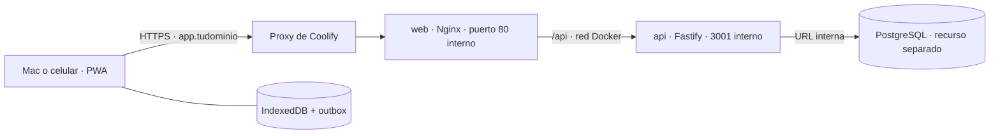

# Arquitectura de Pulso

## Entrada única

El proxy de Coolify termina HTTPS y envía la única ruta de entrada a Nginx. La interfaz usa rutas relativas `/api`; Nginx las reenvía al servicio privado `api`. No hay CORS, segundo subdominio ni exposición de PostgreSQL. Los endpoints que necesita el navegador son accesibles mediante la app autenticada; “API interna” significa sin hostname o puerto público independiente, no que el navegador carezca de acceso a sus funciones.

## Monorepo

npm workspaces y TypeScript comparten esquemas Zod y funciones puras. El frontend se compila con Vite. El backend se empaqueta con tsup, corre como usuario no root y tiene un healthcheck dependiente de PostgreSQL. No hay dependencia de Supabase.

PostgreSQL utiliza tablas de usuarios, sesiones, entidades JSONB tipadas, cambios, operaciones e historial de finalización. Cada registro tiene propietario, tipo, versión y borrado lógico. Los contratos de datos son validados al escribir. Se comprueban relaciones de proyecto, sección, etiquetas, padre, ausencia de ciclos y propiedad de referencias. Las migraciones se ejecutan dentro de una transacción con bloqueo de arranque; las próximas alteraciones deben agregarse como migraciones numeradas, nunca como cambios destructivos automáticos.

## Sincronización

1. Una transacción IndexedDB escribe el estado visible y su operación pendiente juntos. Cada operación tiene UUID, versión base, valores base y campos modificados.
2. Al abrir, reconectar, volver al primer plano y cada 20 segundos con la app visible, se intenta sincronizar. Un Web Lock coordina pestañas del mismo navegador y BroadcastChannel avisa de nuevas operaciones.
3. El servidor aplica operaciones en una transacción y conserva el resultado por UUID para reintentos idempotentes. Un bloqueo transaccional serializa las escrituras y la asignación del cursor; una secuencia SQL por sí sola no garantiza orden de commit.
4. Si una versión está atrasada, campos independientes se fusionan. Un mismo campo modificado de formas distintas queda en conflicto. La UI conserva la variante local y ofrece elegir; la alternativa perdedora se conserva en el ledger de recuperación local y en el respaldo exportado.
5. Las eliminaciones dejan tombstones. Una edición offline no puede resucitar un elemento eliminado. Recuperar desde papelera es una acción explícita con versión.
6. Pull paginado por cursor aplica los cambios remotos y vuelve a superponer operaciones locales todavía pendientes. El cursor solo avanza junto con la escritura local de esos cambios.
7. Las finalizaciones recurrentes se deduplican por tarea y fecha de ocurrencia. Dos dispositivos que completan la misma fecha no deben avanzar dos veces.

El snapshot inicial usa lectura repetible para que su estado y cursor sean consistentes. La versión actual conserva historial y tombstones sin compactación: es apropiado para una instalación personal y requiere vigilar crecimiento a largo plazo.

## Fechas

Las fechas sin hora son cadenas civiles `YYYY-MM-DD`, no medianoche UTC. El servidor calcula el día actual en la zona horaria enviada por el dispositivo. No se implementa aún el calendario completo de reglas de Todoist. Completar una ocurrencia es una regla de dominio; el historial se separa del estado actual de la tarea.

## Autenticación y despliegue

Solo una cuenta inicial, protegida por SETUP_KEY aleatoria de al menos 32 caracteres. Contraseñas derivadas con scrypt y sal aleatoria; sesiones aleatorias de 256 bits guardadas por hash en la DB. Cookies HttpOnly, SameSite=Strict, Secure en producción. Las mutaciones verifican Origin exacto y Content-Type JSON. Hay límites de intentos de login y validación de tamaño.

El gateway aplica CSP, bloqueo de iframes y políticas de contenido. Nunca se cachea `/api` en el service worker. Cambiar de cuenta no mezcla bases locales. Los datos IndexedDB dependen de la seguridad de la cuenta del sistema y del perfil del navegador; no se ofrece cifrado de extremo a extremo ni protección contra una persona que controle el dispositivo desbloqueado.

## Alcance y límites

La PWA es independiente: no descarga datos de la cuenta Todoist. No contiene código ni imágenes extraídos de esa aplicación. Las pruebas de reglas y API no reemplazan una verificación de instalación y permisos en teléfonos físicos.

La captura natural admite un conjunto explícito de patrones; no es un parser de lenguaje natural general. El calendario muestra las tareas actualmente programadas y no expande futuras ocurrencias recurrentes virtuales. Las prioridades se representan como UI 1 = máxima y 4 = normal. La finalización de un padre no completa automáticamente sus subtareas.

La restauración de JSON combina registros de la misma cuenta y no resucita tombstones automáticamente. Los respaldos pueden contener datos personales y deben guardarse en un lugar privado. Adjuntos, comentarios, integración Google/Outlook y migración CSV se rastrean por separado en el progreso; no se atribuyen a una etapa verificada sin pruebas.

## Recordatorios opcionales

Web Push se envía desde un worker del backend con claves VAPID configuradas en el servidor. Se guardan suscripciones por propietario y comprobantes por tarea, instante y suscripción. La revisión corre cada 30 segundos bajo un bloqueo para impedir ciclos paralelos. La entrega puede reintentarse y no se promete exactamente una vez frente a fallos entre la entrega de red y el commit; el tag del aviso usa la tarea. La validación local cubre contratos y rechazo de destinos arbitrarios; falta comprobar la entrega real en HTTPS y en cada plataforma.
